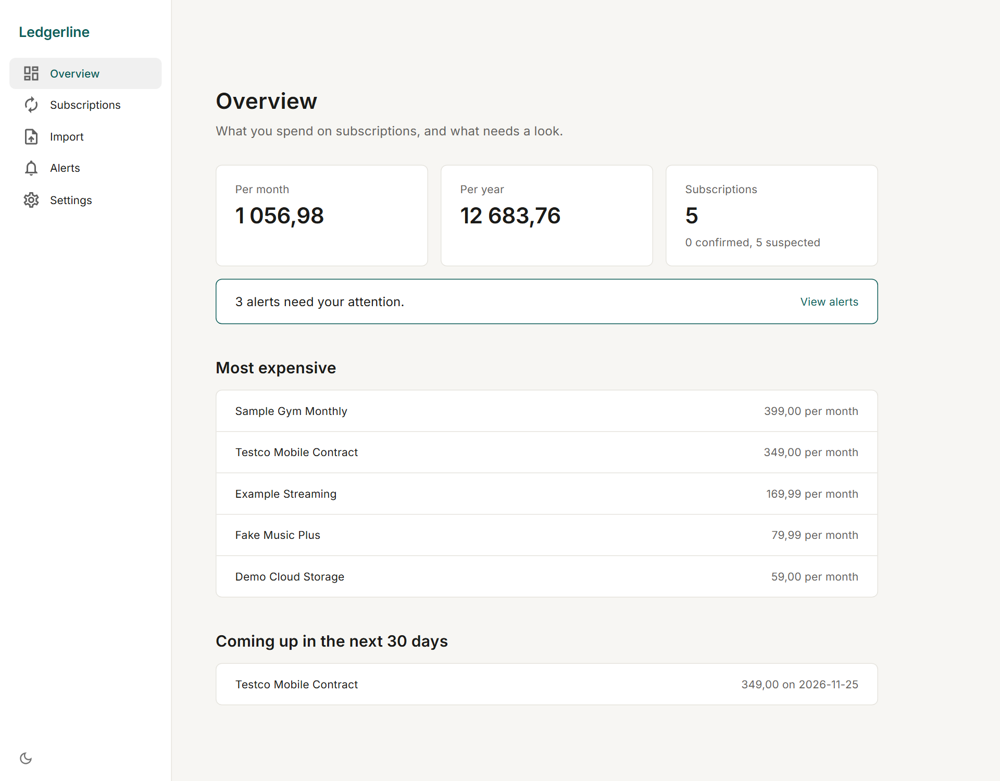
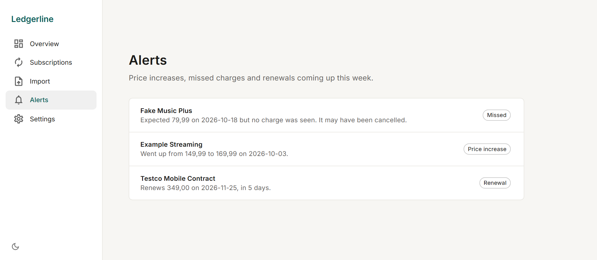
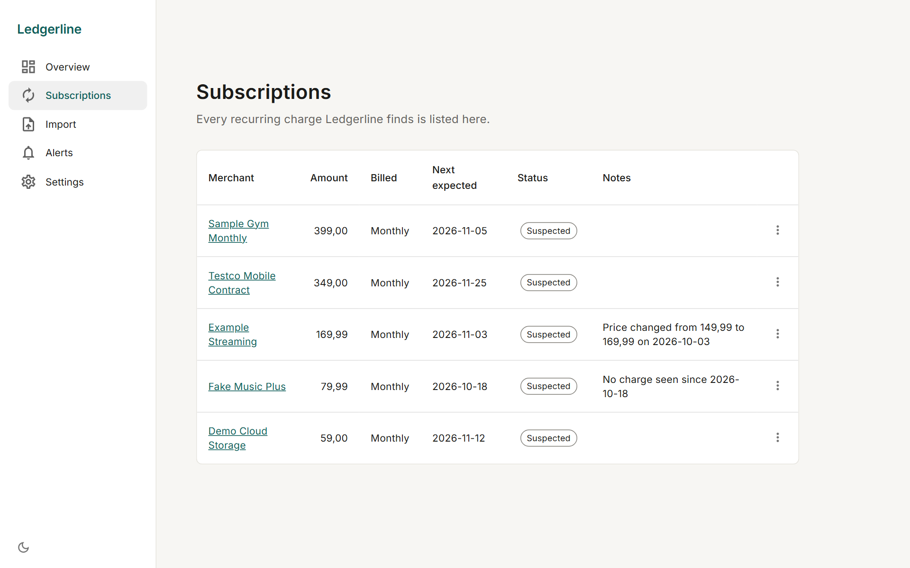
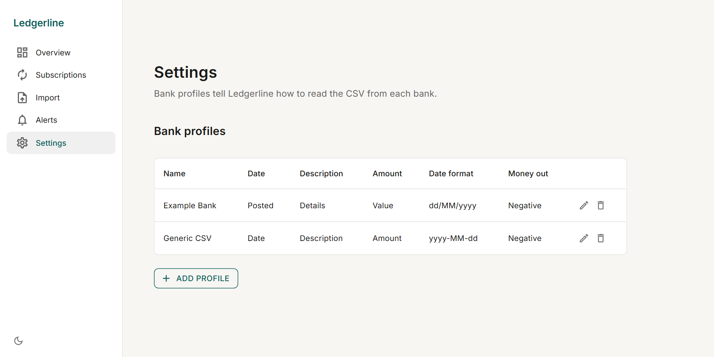

<div align="center">

# 📒 Ledgerline

**Find the subscriptions hiding in your bank statements. Everything stays on your computer.**

[](https://github.com/MrPettitt/ledgerline/actions/workflows/ci.yml)
[](https://github.com/MrPettitt/ledgerline/releases)


[](LICENSE)

No account. No cloud. No sign-in.

</div>

<p align="center">
  
  
</p>

<p align="center">
  
  
</p>

<p align="center">
  
</p>

All data in the screenshots is invented. The merchants come from [`samples/sample-statement.csv`](samples/sample-statement.csv).

## At a glance

| | |
|---|---|
| 📥 **Import** | Bank statement CSVs, read with a configurable bank profile. Importing the same file twice adds nothing |
| 🔎 **Detect** | Recurring debits are found automatically: weekly, monthly, quarterly and yearly |
| 📈 **Price changes** | A subscription that gets more expensive is flagged with the old and new price |
| ⏰ **Renewals** | Warnings a week before a renewal, and when an expected charge never arrives |
| ✅ **Review** | Confirm, ignore or cancel each subscription. Your choice survives re-imports |
| 🌗 **Themes** | Light by default, dark mode in one click |
| 🔒 **Privacy** | One local SQLite file. Nothing is sent anywhere |

## Project status

Current version: **v0.3.1**. This is a portfolio project. It is not a finished product and has only been used with invented data.

| Check | Status | Notes |
|---|---|---|
| Build and tests in CI | ✅ Passing | Runs on every push and pull request |
| Unit tests | ✅ 70 passing | Parser, bank profiles, merchant matching, importer, detector, alerts, summary, statuses and a migration smoke test |
| Windows release build | ✅ Checked | The published build runs from its own folder and serves pages, styles and the font. Checked on a machine that also has .NET installed |
| Pages in a browser | ✅ Checked | Overview, Subscriptions, Import, Alerts and Settings exercised with invented data. Dark theme spot-checked |
| A real bank export | 🟡 Not tested | Only the Generic CSV layout below has been used. Your bank may need its own profile |
| Bank profile editor | ✅ Checked | Add, edit and delete profiles on Settings, then import with a new layout. Validation and delete protection tried in a browser |
| Phones and narrow windows | 🟡 Not designed for | The navigation is a fixed side panel |
| Accessibility | ✅ Audited, see below | Contrast, structure, keyboard and reflow checked on every page in both themes. No screen reader testing yet |

## Release history

| Version | What it added |
|---|---|
| v0.3.1 | Accessibility fixes: contrast, landmarks and headings, skip link, visible keyboard focus, narrow screens |
| v0.3.0 | Bank profile editor on the Settings page, and column names that ignore capital letters |
| v0.2.0 | Overview page: monthly and yearly spend, alerts callout, most expensive subscriptions, renewals in the next 30 days |
| v0.1.0 | First release: app shell, CSV import, subscription detection, Alerts page, confirm, ignore and cancel controls, light and dark themes |

## How it works

1. **Import.** Pick a bank profile and a CSV. Ledgerline reads the date, description and amount columns, keeps the debits and drops credits such as salary.
2. **Group by merchant.** Bank descriptions carry reference numbers that change on every charge, so `EXAMPLE STREAMING 8841` and `EXAMPLE STREAMING 9120` are treated as one merchant. Words containing digits are dropped to build the merchant key.
3. **Detect.** For each merchant the detector looks at the gaps between charges and at the amounts:

   | Rule | Value |
   |---|---|
   | Minimum charges | 2 |
   | Weekly | every 6 to 8 days |
   | Monthly | every 26 to 35 days |
   | Quarterly | every 84 to 97 days |
   | Yearly | every 355 to 375 days |
   | Same price | amounts within 2% of each other |
   | Price change | one allowed in up to 8 charges (one more per 4 after that), never with only 2 charges, and no more than 50% in one step |
   | Missed | the next expected date plus 5 days (2 for weekly) passed with no charge |

   Every gap must fit one cadence. Spending that changes on almost every visit, such as groceries or fuel, is rejected even when the dates happen to look regular.
4. **Record events.** Each recurring charge becomes a renewal event, a changed amount becomes a price change event, and a charge that never arrived becomes a missed event. Re-running detection never duplicates events.
5. **Review.** New finds start as **Suspected**. Mark them **Confirmed**, **Ignored** or **Cancelled** from the menu on each row. Ignored and cancelled subscriptions drop out of totals and alerts.
6. **Alert.** The Alerts page shows missed charges, price increases from the last 90 days and renewals due within 7 days.

"Missed" is judged against the last date in your imported data, not today's date, so an old statement does not flag everything as missed.

## Features

- **Statement import**: choose a bank profile and a CSV up to 5 MB. The result shows how many debits were read, added and skipped as already imported.
- **Duplicate-safe**: every transaction gets a fingerprint from its date, description, amount and its position among identical rows. Re-importing an overlapping statement adds only the new rows, and two identical coffees on one day are both kept.
- **Clear errors**: a missing column, a date in the wrong format or a value that is not an amount stops the import with a message that names the row.
- **Bank profiles**: add, edit and delete the CSV layouts on the Settings page. The date format shows a live example, column names ignore capital letters, and a profile that statements were imported with cannot be deleted.
- **Subscriptions table**: amount, billing interval, next expected date, status and a note such as `Price changed from 149,99 to 169,99 on 2026-10-03`.
- **Overview**: monthly and yearly totals. Weekly, quarterly and yearly subscriptions are converted to a monthly cost so they can be added up.
- **Alerts**: missed charges first, then price increases, then renewals by date. Price decreases are not flagged.
- **Your choices are kept**: re-running detection updates amounts and dates but never overwrites a status you set.
- **Light and dark themes**: warm off-white and white surfaces with one teal accent. Inter is bundled with the app, so no fonts are loaded from the internet.
- **Local storage**: one SQLite file, `ledgerline.db`, next to the app. Money is stored as `decimal`.

## Accessibility

Ledgerline was checked against the WCAG 2.2 level AA criteria that can be tested on a page. The checks ran on all five pages in the light and dark themes, including the error and result messages.

| Area | What was checked | Result |
|---|---|---|
| Colour contrast | The contrast of every visible piece of text against its real background, 4.5:1 for normal text and 3:1 for large text | ✅ Passes. Status colours (success, error, warning, info) and the dark theme's button text were darkened or lightened to get there |
| Form fields | Input borders against the background, labels and helper text | ✅ Borders are at least 3:1 |
| Structure | One `main` landmark, one `nav`, one `h1` per page, headings in order, page titles, `lang` | ✅ Passes |
| Names | Every link, button and input has an accessible name. Icon buttons carry `aria-label`s and the table's actions column has a hidden heading | ✅ Passes |
| Keyboard | Tab order, a "Skip to main content" link, and a 2px teal focus outline on every control | ✅ Passes |
| Messages | Import results, import errors and form errors are announced through live regions | ✅ Passes |
| Reflow | No horizontal scrolling at 320 px wide. The side panel becomes a strip on top and tables turn into labelled rows | ✅ Passes |
| Target size | Buttons and links are at least 24 by 24 px | ✅ Passes |
| Motion | Animations and transitions are removed when the system asks for reduced motion | ✅ Passes |

Not done: testing with a screen reader (NVDA, JAWS or VoiceOver), automated scanners such as axe or Lighthouse, and any component state not reachable from these pages. The checks were scripted against the running app, so they cover what is on screen, not every possible state.

## Privacy and security

- The app makes no outbound requests. Fonts, icons and styles are bundled.
- It listens on `localhost` only and rejects other host names. There is no login, so do not expose it beyond your own computer. See [SECURITY.md](SECURITY.md).
- Your data lives in `ledgerline.db`. Delete the file to start again.
- `.gitignore` blocks `*.db`, `*.csv`, `*.pdf` and `*.ofx` everywhere except the `samples` folder, so a real statement cannot be committed by accident.
- Everything under `samples` and in the tests uses invented merchants.

## Tech stack

| Layer | Technology |
|---|---|
| Language | C# on .NET 10 |
| UI | Blazor Web App (interactive server), MudBlazor 9 |
| Data | Entity Framework Core 10 with SQLite |
| CSV | CsvHelper 33 |
| Testing | xUnit with temporary SQLite databases, no mocks |
| CI | GitHub Actions: build and test on every push |
| Releases | GitHub Actions: a `v*` tag builds a self-contained Windows zip and publishes a release |

## Project structure

```
src/
├── Ledgerline.Core/        # Logic only. No UI or database references
│   ├── Domain/             # Entities and enums
│   ├── Importing/          # Statement parser, bank profile validation, merchant keys, fingerprints
│   ├── Detection/          # Subscription detector and cadence rules
│   ├── Alerts/             # Alert builder
│   └── Summary/            # Overview totals and monthly cost
├── Ledgerline.Data/        # EF Core context, migrations, importer and detection services
└── Ledgerline.Web/         # Blazor app
    ├── Components/Layout/  # Main layout, navigation, page header
    ├── Components/Pages/   # Overview, Subscriptions, Import, Alerts, Settings
    ├── LedgerlineTheme.cs  # Colours, radius and typography
    └── wwwroot/            # Styles and the bundled Inter font
tests/
└── Ledgerline.Tests/       # xUnit tests
samples/                    # Invented statement for trying the app
docs/screenshots/           # Images used in this README
```

Core references nothing. Data references Core. Web references Core and Data.

### Data model

| Entity | Purpose |
|---|---|
| `BankProfile` | Column names, date format and debit sign for one bank's CSV layout |
| `StatementImport` | One imported file |
| `Transaction` | One debit, with a fingerprint used to skip duplicates |
| `Merchant` | A normalised merchant key and display name |
| `Subscription` | A merchant's recurring charge: cadence, current amount, dates and status (`Suspected`, `Confirmed`, `Ignored`, `Cancelled`) |
| `SubscriptionEvent` | `PriceChange`, `Renewal` or `Missed`, with the amounts involved |

## Getting started

### Use a release

1. Download the zip from the [Releases](https://github.com/MrPettitt/ledgerline/releases) page.
2. Unzip it and run `Ledgerline.Web.exe`.
3. Open http://localhost:5000.

The build is self-contained, so no .NET install is needed. Windows only for now.

### Build from source

**Requirements:** the .NET 10 SDK.

```bash
git clone https://github.com/MrPettitt/ledgerline.git
cd ledgerline
dotnet run --project src/Ledgerline.Web
```

Then open http://localhost:5101. Migrations are applied automatically on startup.

### Try it with the sample

On the Import page choose `samples/sample-statement.csv` with the **Generic CSV** profile. It contains five subscriptions and some ordinary spending:

- `EXAMPLE STREAMING` goes up from 149.99 to 169.99 in October.
- `FAKE MUSIC PLUS` is charged in August and September, then not again.
- `SAMPLE GYM MONTHLY`, `DEMO CLOUD STORAGE` and `TESTCO MOBILE CONTRACT` repeat at a fixed price.
- Groceries, fuel and cafe visits are ignored, and the salary is skipped as a credit.

### Bank profiles and the Generic CSV layout

Open **Settings** to add a profile for your bank: the names of its date, description and amount columns, the date format, and whether money going out is negative. One profile ships with the app, **Generic CSV**, which expects a header row like this:

```
Date,Description,Amount
2026-08-03,EXAMPLE STREAMING 8841,-149.99
```

Dates are `yyyy-MM-dd`, money going out is negative, and extra columns such as `Balance` are ignored. Amounts are shown using your computer's regional number format, and no currency symbol is added.

### Run the checks

```bash
dotnet build
dotnet test
```

The same commands run on every push through GitHub Actions.

### Add a migration

```bash
dotnet ef migrations add NameOfChange -p src/Ledgerline.Data -s src/Ledgerline.Web -o Migrations
```

### Publish a release

```bash
git tag v0.3.0
git push origin v0.3.0
```

The release workflow runs the tests, builds the zip and creates the release with generated notes.

## Roadmap

- A ready-made profile for Standard Bank once a real export's headers are known
- Remember the theme choice between visits
- Dismiss an alert you have dealt with
- Spending history per subscription
- A layout that works on narrow screens

## License

[MIT](LICENSE)
